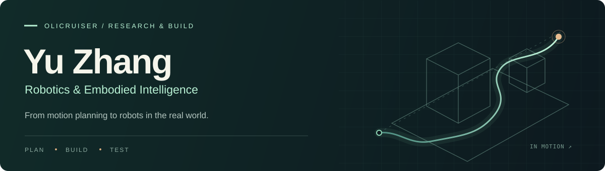

  

  <a href="https://github.com/OliCruiser">GitHub</a> &nbsp; / &nbsp;
  <a href="mailto:zhang2023@mail.nwpu.edu.cn">Email</a>

### A little about me

I'm **Yu Zhang (张煜)**, a Mechatronics undergraduate at **Northwestern Polytechnical University**, School of Mechanical Engineering.

My experience spans motion planning, autonomous flight, and robot electronics. I'm interested in **embodied intelligence**, especially **Vision-Language-Action (VLA) models**, and how intelligent policies translate into reliable behavior on physical robots.

我喜欢把算法放到真实机器人上验证：从机械臂轨迹规划、无人机自主飞行，到双足机器人的电控与整机联调。接下来，希望深入探索具身智能与 VLA。

### Selected work

#### 01 / Multimodal motion planning for manipulators

**Independent project · Oct 2025 – Jan 2026**

Low-dimensional joint trajectory parameterization with **Bernstein polynomials**, preserving start and goal configurations. Combined cost-weighted density estimation with an importance-weighted variational Bayesian Gaussian mixture model to identify trajectory modes, then locally optimized each mode. Visualized robot motion in **CoppeliaSim**.

#### 02 / Autonomous flight, from simulation to hardware

**Platform integration · Algorithm reproduction · Real-world experiments**

Built a quadrotor platform and reproduced autonomous obstacle avoidance in simulation. Validated exploration in an unknown environment on the physical platform, with environment maps and localization trajectories as experimental outputs.

#### 03 / Electronics for a dancing biped

**Technical lead · Jul 2025 – May 2026**

Designed, soldered, and debugged **STM32 control boards**, peripheral boards, and an audio amplifier board. Developed embedded software and serial communication with a **Raspberry Pi 5**, contributing to a robot with **17 coordinated servos** and two switchable configurations.

*National undergraduate innovation project · Completed with an Excellent rating*

### Tools I work with

| Area | Tools & experience |
| :--- | :--- |
| Programming | C · Python |
| Planning & simulation | Trajectory optimization · CoppeliaSim · Gazebo |
| Robot systems | STM32 · Raspberry Pi · Serial communication · Servo control |
| Hardware | Altium Designer · LCEDA · PCB design, soldering & debugging |

### A few milestones

- **National champion × 2** — 2025 China Robot Competition & RoboCup China, main and special competitions; second team lead.
- **National second prize** — 2024 special competition, China Robot Competition & RoboCup China; team lead.
- **Beijing Jingdiao Special Scholarship** — 2025.
- **University First-Class Scholarship** — 2025 & 2026.

More awards & activities

- National third prize, 18th Advanced Robotics and Simulation Technology Competition (2025).
- National third prize, RAICOM (2025).
- Provincial first prize, iCAN Northwest regional selection (2024).
- Provincial second prize, National 3D Digital Innovation Design Competition, 17th Anniversary Elite League (2025).
- Dance team lead and electronics team member, university dancing robot innovation practice base.

---

Open to conversations about motion planning, embodied intelligence, and building robots. Reach me at **[zhang2023@mail.nwpu.edu.cn](mailto:zhang2023@mail.nwpu.edu.cn)**.
